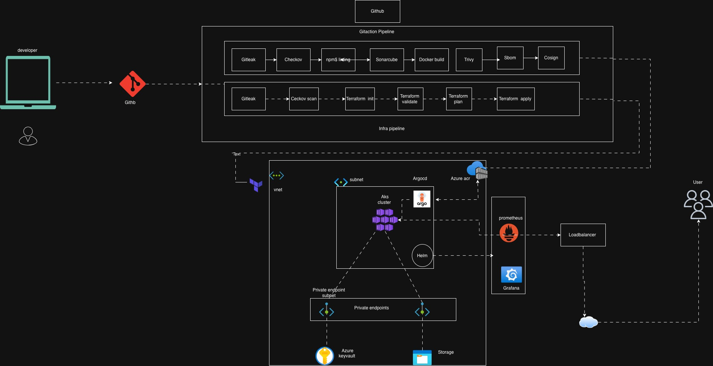
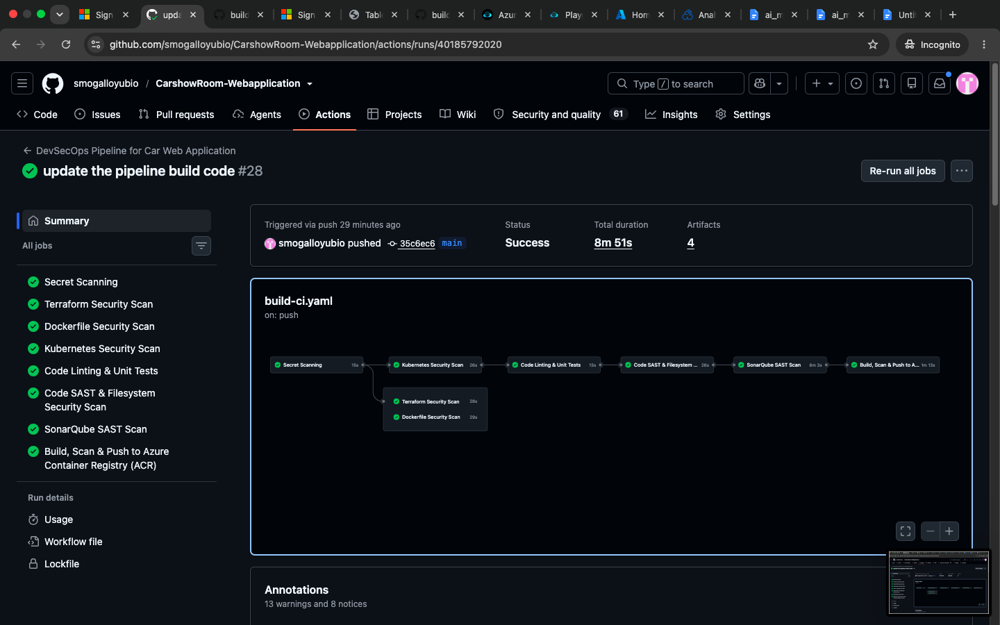
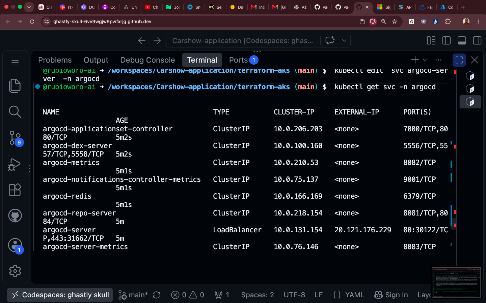
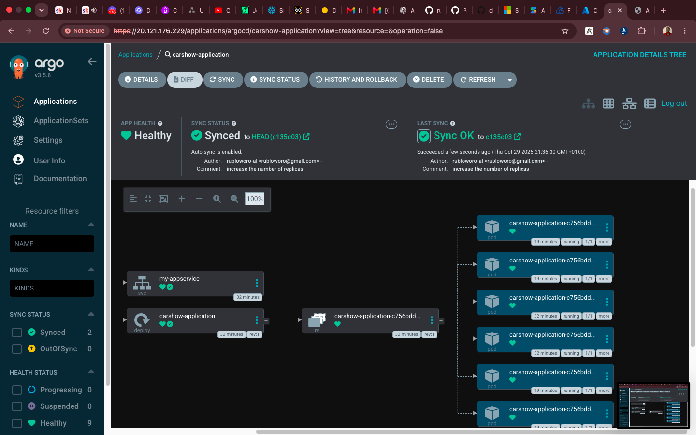

# Table & Taste — Azure AKS Cloud-Native Deployment

A cloud-native deployment project for **Table & Taste**, a React restaurant web application. This repository brings together Azure infrastructure provisioning with Terraform, containerization with Docker, Kubernetes deployment manifests, and GitHub Actions workflows for infrastructure automation and application security checks.

The project demonstrates how application development, Infrastructure as Code (IaC), containerization, Kubernetes, and DevSecOps practices can be brought together in a cloud environment.

> **Project scope:** This repository contains the restaurant frontend application and its cloud deployment implementation. Application features include menu browsing, online ordering, reservations, and customer-facing pages. Payment functionality should be treated as a demonstration unless connected to a real payment provider.

---

## Table of Contents

- [Project Overview](#project-overview)
- [Architecture](#architecture)
- [Technology Stack](#technology-stack)
- [Repository Structure](#repository-structure)
- [Azure Infrastructure Provisioning](#1-azure-infrastructure-provisioning-with-terraform)
- [Containerization](#2-containerizing-the-react-application)
- [Kubernetes Deployment](#3-kubernetes-deployment)
- [CI/CD and DevSecOps](#4-github-actions-cicd-and-devsecops)
- [Argo CD and Monitoring](#5-argo-cd-and-monitoring)
- [Prerequisites](#prerequisites)
- [Deployment Guide](#deployment-guide)
- [Security Considerations](#security-considerations)
- [Implementation Notes](#implementation-notes)
- [What I Learned](#what-this-project-demonstrates)

---

## Project Overview

The objective of this project is to build and prepare a React web application for deployment on Azure Kubernetes Service (AKS).

The infrastructure is provisioned using Terraform, while Docker packages the application into a container image. Kubernetes manifests define the application workload and expose it through a LoadBalancer Service.

GitHub Actions is used to automate infrastructure checks, application validation, and security scanning.

### Key objectives

- Provision Azure infrastructure using reusable Terraform modules.
- Create an Azure Kubernetes Service cluster.
- Configure Azure Virtual Network and subnet resources for AKS.
- Provision Azure Storage resources.
- Build and package the React application using Docker.
- Define Kubernetes Deployment and Service resources.
- Automate infrastructure and application checks with GitHub Actions.
- Integrate security scanning, SBOM generation, and container image signing.
- Install Argo CD and Prometheus/Grafana on the Kubernetes cluster using Helm.

---

## Architecture


---

## Technology Stack

| Category | Technologies |
|---|---|
| Frontend | React, TypeScript |
| Build Tool | Vite |
| Styling | Tailwind CSS |
| Cloud Platform | Microsoft Azure |
| Kubernetes | Azure Kubernetes Service |
| Infrastructure as Code | Terraform |
| Containerization | Docker |
| Web Server | Nginx |
| CI/CD | GitHub Actions |
| IaC Security | Checkov |
| Secret Scanning | Gitleaks |
| Static Analysis | Semgrep, SonarQube |
| Vulnerability Scanning | Trivy |
| SBOM Generation | Syft |
| Image Signing | Cosign |
| GitOps Tool | Argo CD |
| Monitoring | Prometheus and Grafana |
| Package Management | Helm |

---

## Repository Structure
```
.
├── .github/
│   └── workflows/
│       ├── build-pipeline.yml
│       └── infra-pipeline.yml
│
├── k8s-manifest/
│   ├── deployment.yaml
│   └── service.yaml
│
├── src/
│   └── React application source code
│
├── terraform-aks/
│   ├── modules/
│   │   ├── network/
│   │   ├── compute/
│   │   └── storage.tf/
│   │
│   ├── backend.tf
│   ├── main.tf
│   ├── providers.tf
│   ├── variable.tf
│   ├── terraform.tfvars
│   └── output.tf
│
├── Dockerfile
├── nginx.conf
├── install-tools.sh
├── python.py
├── .env.example
└── README.md
```

---

## 1. Azure Infrastructure Provisioning with Terraform

Terraform is used to provision and manage the Azure infrastructure.
The Terraform configuration is organized into modules to separate infrastructure responsibilities and make the configuration easier to maintain.

### Infrastructure components
**Azure Resource Group**
The Terraform configuration references an existing Azure Resource Group where the infrastructure resources are deployed.
**Azure Virtual Network**
The network module provisions an Azure Virtual Network and a subnet for the AKS node pool.
Configured address ranges include:

- Virtual Network address space: `10.0.0.0/16` and `10.20.0.0/16`
- AKS subnet: `10.20.1.0/24`

These are the current configuration values and should be reviewed before deployment.
**Azure Kubernetes Service**
The compute module provisions an AKS cluster with:

- Configurable node count.
- Configurable virtual machine size.
- System-assigned managed identity.
- Azure network plugin.
- Azure network policy.
- Standard Load Balancer SKU.
- AKS node pool connected to the configured subnet.

The current Terraform defaults specify one node and the `Standard_D2s_v3` virtual machine size.

**Azure Storage Account**

The storage module provisions:

- Azure Storage Account.
- Standard performance tier.
- Locally redundant storage (LRS).
- Private Blob Storage container.

### Terraform remote state

Terraform remote state is configured using the AzureRM backend.
The backend configuration stores Terraform state in an Azure Blob Storage container rather than relying on a local state file.
This supports centralized state management and helps prevent different deployments from working with separate local copies of infrastructure state.
The backend configuration is located in:

`terraform-aks/backend.tf`

**Important:** The backend Storage Account and container must exist before Terraform initializes the backend. Access should be restricted and managed securely.

### Infrastructure provisioning workflow

The infrastructure GitHub Actions workflow is configured to:

1. Check out the repository.
2. Run Checkov against the Terraform configuration.
3. Authenticate to Azure.
4. Configure Azure authentication environment variables.
5. Install Terraform CLI.
6. Initialize the Azure remote backend.
7. Validate Terraform configuration.
8. Check Terraform formatting.
9. Import existing state-storage resources when necessary.
10. Generate a Terraform execution plan.
11. Apply the saved plan on qualifying pushes to the main branch.

The workflow uses GitHub Actions secrets for authentication.

---

## 2. Containerizing the React Application
Docker is used to package the React application into a container image.
The Dockerfile uses a **multi-stage build** to separate the application build environment from the final runtime environment.
### Stage 1: Build the application
The build stage uses Node.js 20 Alpine.
It performs the following operations:

1. Copies the package configuration files.
2. Installs dependencies using `npm ci`.
3. Copies the application source code.
4. Runs the Vite production build.
5. Generates the production files in the `dist` directory.

### Stage 2: Serve the application with Nginx
The runtime stage uses Nginx Alpine.
1. Copies the compiled frontend files from the build stage.
2. Places the files in the Nginx web directory.
3. Copies the custom Nginx configuration.
4. Exposes port 80.
5. Starts Nginx in the foreground.

This approach keeps Node.js build dependencies out of the final runtime image.

### Build and run locally

Build the Docker image:

```
docker build -t table-and-taste:local .
```
Run the container:
```
docker run --rm -p 8080:80 table-and-taste:local
```

Open the application:

```
http://localhost:8080
```

---

## 3. Kubernetes Deployment

The `k8s-manifest` directory contains the Kubernetes resources used to define the application workload.
### Deployment
The Deployment configuration defines:

- Application name: `my-app`
- Namespace: `nimbus-dev`
- Desired replicas: 3
- Container port: 80
- ACR image reference.
- Image pull secret: `acr-secret`

Kubernetes maintains the desired number of application replicas.

If a pod fails, the Deployment controller works to maintain the desired replica count.
### Service
The Service uses:

- Type: `LoadBalancer`
- Port: 80
- Target port: 80
- Selector: `app: my-app`

The LoadBalancer Service exposes the application through an Azure Load Balancer, subject to the AKS networking configuration.
### Deploying the manifests

Create the namespace:

```
kubectl create namespace nimbus-dev
```

Ensure the `acr-secret` image pull secret exists in that namespace, or configure an appropriate AKS-to-ACR integration.

Apply the Kubernetes resources:

```
kubectl apply -f k8s-manifest/
```
Check the Deployment:
```
kubectl get deployments -n nimbus-dev
```
Check the pods:

```
kubectl get pods -n nimbus-dev
```

Check the Service:
```
kubectl get svc -n nimbus-dev
```

---

## 4. GitHub Actions CI/CD and DevSecOps

GitHub Actions is used to automate application validation, security scanning, and infrastructure provisioning.
The repository contains two separate workflows.
### Application workflow

File:
`.github/workflows/build-pipeline.yml`

The application workflow contains several security and quality checks.

| Pipeline Stage | Tool | Purpose |
|---|---|---|
| Secret scanning | Gitleaks | Detect exposed credentials and secrets |
| Infrastructure and manifest scanning | Checkov | Scan Terraform, Dockerfile and Kubernetes configuration |
| Linting | TypeScript / configured lint command | Check application code |
| Unit testing | npm test | Execute the configured test command |
| Static analysis | Semgrep | Identify potential code security issues |
| Filesystem scanning | Trivy | Scan project dependencies and filesystem |
| Code analysis | SonarQube | Perform code quality and security analysis |
| Image scanning | Trivy | Scan container image vulnerabilities |
| SBOM generation | Syft | Generate an SPDX JSON software bill of materials |
| Image signing | Cosign | Sign the container image |
| SBOM attestation | Cosign | Attach and verify SBOM attestation |

### Infrastructure workflow

File:

`.github/workflows/infra-pipeline.yml`
The infrastructure workflow automates Terraform operations.
Its configured stages include:
- Terraform security scanning with Checkov.
- Azure authentication.
- Terraform initialization.
- Terraform validation.
- Terraform formatting.
- Terraform planning.
- Terraform apply.

### Security scanning

**Gitleaks**

Scans the repository for accidentally committed secrets.

**Checkov**

Checks Terraform, Dockerfile, and Kubernetes configuration against security policies.

**Semgrep**

Performs static analysis of the application source code.

**Trivy**

Scans the filesystem and container image for vulnerabilities.

**SonarQube**

Performs application code analysis.

### Software Bill of Materials

Syft is used to generate an SBOM in SPDX JSON format.

An SBOM provides information about the software components included in the application.

The workflow uploads the generated SBOM as a GitHub Actions artifact.

### Container image signing with Cosign

Cosign is used for keyless image signing through the configured GitHub Actions identity.

The workflow also attempts to attach an SBOM attestation and verify the image signature and attestation.

This demonstrates an approach to improving container image provenance and software supply-chain security.

---


## 5. Argo CD and Monitoring

The repository includes an `install-tools.sh` script for installing Kubernetes add-ons using Helm.

The script connects to the AKS cluster and installs the following tools.

### Argo CD

Argo CD is installed in the `argocd` namespace.

It provides GitOps-based application delivery capabilities by reconciling Kubernetes resources against Git-defined desired state.



### Prometheus and Grafana

The kube-prometheus-stack Helm chart is installed in the `monitoring` namespace.

It provides:

- Prometheus for metrics collection.
- Grafana for metrics visualization.
- Kubernetes monitoring components included in the Helm chart.

The current helper script configures Grafana and the Argo CD server with LoadBalancer services.

**Security note:** This is a lab/demo convenience configuration. Administrative interfaces should not be exposed publicly without appropriate access controls, TLS, and network restrictions.

---

## Prerequisites

Before deploying the project, prepare the following tools and resources:

- Azure subscription.
- Existing Azure Resource Group.
- Azure CLI.
- Terraform CLI.
- Docker.
- kubectl.
- Helm.
- GitHub repository.
- Azure Container Registry.
- GitHub Actions secrets for the required authentication and scanning integrations.

---

## Deployment Guide

### Step 1: Clone the repository

```
git clone https://github.com/smogalloyubio/azure-aks-web-platform.git

cd azure-aks-web-platform
```

### Step 2: Review Terraform configuration

Navigate to the Terraform directory:

```
cd terraform-aks
```

Review:

- `backend.tf`
- `providers.tf`
- `main.tf`
- `variable.tf`
- `terraform.tfvars`

Ensure that resource names, Azure region, resource group, backend storage, and network ranges match your environment.

### Step 3: Initialize Terraform

```
terraform init
```

### Step 4: Validate the configuration

```
terraform fmt -check -recursive
terraform validate
```

### Step 5: Review the execution plan

```
terraform plan
````

### Step 6: Provision the infrastructure

Only after reviewing the plan and confirming the target Azure subscription and expected costs:

```
terraform apply
```

### Step 7: Build the application image

Return to the repository root:

```
cd ..
```

Build the image:

```
docker build -t table-and-taste:local .
```

### Step 8: Connect to AKS

Use the appropriate resource group and AKS cluster name for your environment:

```
az aks get-credentials 
  --resource-group YOUR_RESOURCE_GROUP 
  --name YOUR_AKS_CLUSTER 
  --overwrite-existing
```

Verify connectivity:

```
kubectl get nodes
```

### Step 9: Deploy the application

Ensure the Kubernetes Deployment image references the correct image in your Azure Container Registry and that AKS can pull it.

Then run:

```
kubectl apply -f k8s-manifest/
```

Verify the workload:

```
kubectl get deployments,pods,svc -n nimbus-dev
```

### Step 10: Install cluster add-ons

Review `install-tools.sh` and configure the correct cluster name and resource group before executing it.

The script installs Argo CD and the Prometheus/Grafana stack using Helm.

---

## Security Considerations

Security is considered throughout the infrastructure and application workflows.

Important practices include:

- Use GitHub Actions secrets for sensitive pipeline configuration.
- Avoid committing credentials, API keys, passwords, and kubeconfig files.
- Use managed identities or workload identity where supported.
- Restrict access to the Terraform remote state backend.
- Review Terraform plans before applying infrastructure changes.
- Scan container images before publishing them.
- Generate and retain SBOM artifacts.
- Sign container images and verify signatures.
- Restrict access to monitoring and GitOps administrative interfaces.
- Avoid storing administrative passwords in plaintext files.
- Review Azure network exposure and resource costs.

---

## Implementation Notes

The repository contains the building blocks for this architecture, but the following configuration items should be reviewed before presenting the project as a fully automated production deployment.

### 1. Docker image and registry consistency

The current application workflow uses different image names and registry destinations in its build, push, signing, and Kubernetes configuration.

These must be aligned so that:

- The image is built with the intended ACR name.
- The image is pushed to the correct ACR repository.
- Cosign signs the image that was actually pushed.
- Kubernetes references the same image and tag.

### 2. GitHub Actions workflow trigger

The application workflow filename is `build-pipeline.yml`, while its path filter references `build-pipeline.yaml`.

The path filter should match the actual filename.

### 3. Terraform formatting

Use:

```
terraform fmt -check -recursive
```

This checks formatting without modifying the runner's files.

### 4. Azure authentication

Environment-specific Azure identifiers should be supplied through variables or supported environment variables rather than hardcoded provider configuration.

Prefer federated credentials/OIDC where possible instead of long-lived client secrets.

### 5. Credential handling

Review `python.py` and `install-tools.sh` before using them.

The credential helper generates a local Azure credentials JSON file, while the installation script writes administrative passwords to local plaintext files.

Do not commit generated credentials or password files. Rotate any real credential that may have been exposed.

### 6. GitOps deployment

Argo CD is installed by the helper script, but the repository should also contain a configured Argo CD Application or ApplicationSet if GitOps deployment is intended to be automated.

## What This Project Demonstrates

Through this project, I gained practical experience with:

- Designing modular Terraform configurations.
- Provisioning Azure infrastructure.
- Configuring Azure Virtual Networks and AKS subnets.
- Deploying Azure Kubernetes Service.
- Configuring Azure Blob Storage for Terraform remote state.
- Building optimized multi-stage Docker images.
- Serving React applications using Nginx.
- Defining Kubernetes Deployments and Services.
- Automating infrastructure and application workflows with GitHub Actions.
- Integrating security scanning into CI pipelines.
- Generating SBOMs with Syft.
- Signing container images and creating attestations with Cosign.
- Installing Argo CD, Prometheus, and Grafana on Kubernetes.

---
## Project Repository
**GitHub:** https://github.com/smogalloyubio/azure-aks-web-platform


